<picture>
  <source media="(prefers-color-scheme: dark)" srcset="./assets/hero-dark.svg">
  <source media="(prefers-color-scheme: light)" srcset="./assets/hero-light.svg">
  
</picture>

## はじめまして、NiAkaです。

TypeScriptを中心に、Webアプリケーションの設計・開発・運用をしています。個人では、VRChatのワールドやギミック、Unity向けのツールを作っています。AIエージェントにUdonSharpをちゃんと書かせるためのOSSも育てています。

*Full-stack web engineer. I also build VRChat worlds and tools, and maintain open-source skills that help coding agents write better UdonSharp.*

<picture>
  <source media="(prefers-color-scheme: dark)" srcset="./assets/stats-dark.svg">
  <source media="(prefers-color-scheme: light)" srcset="./assets/stats-light.svg">
  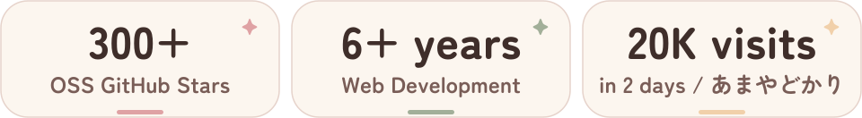
</picture>

<p align="center">
  <a href="#latest--最近の仕事">最近の仕事</a> ·
  <a href="#open-source">Open Source</a> ·
  <a href="#vrchat-worlds">VRChat Worlds</a> ·
  <a href="#niakado--niaka堂">NiAka堂</a> ·
  <a href="#web-development">Web Development</a> ·
  <a href="#collaborations--制作協力技術協力">制作協力・技術協力</a>
</p>


## Latest / 最近の仕事

<a href="https://site.shijukairadio.com/">
  <picture>
    <source media="(prefers-color-scheme: dark)" srcset="./assets/hoboradio-dark.svg">
    <source media="(prefers-color-scheme: light)" srcset="./assets/hoboradio-light.svg">
    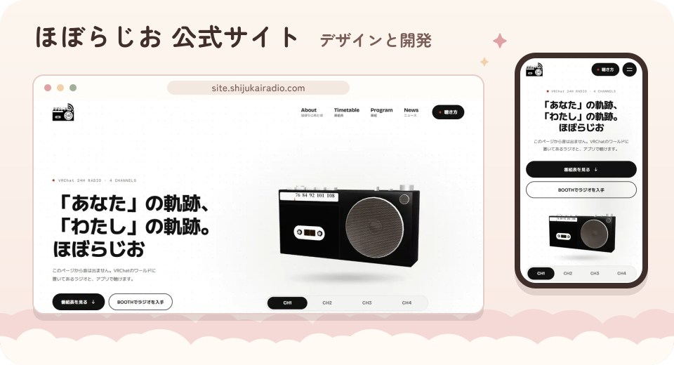
  </picture>
</a>

- **[ほぼらじお 公式サイト](https://site.shijukairadio.com/)**（2026.11 · Webサイト）— VRChatの24時間ラジオ「ほぼらじお」の公式サイト。デザインと開発を担当しました。

<p align="center"><a href="https://niaka.booth.pm/items/9123231">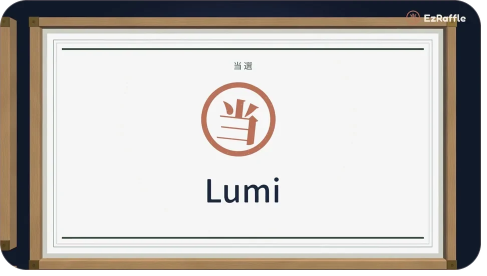</a><a href="https://x.com/Riisya_Sweets/status/2116795253256757515">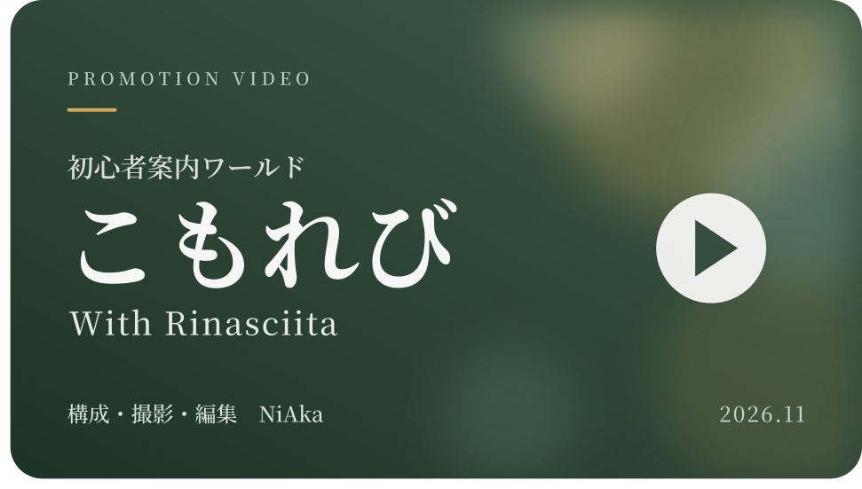</a></p>

- **[EzRaffle](https://niaka.booth.pm/items/9123231)**（2026.11 · BOOTH · 無料）— 参加ボタンで集めて、朱印スタンプで当選を発表するワールド用の抽選ギミック。[紹介動画](https://youtu.be/PW7CprpCrsA)
- **[こもれび プロモーション動画](https://x.com/Riisya_Sweets/status/2116795253256757515)**（2026.11 · 制作協力）— リーシャさんのワールドの宣伝動画。構成・撮影・編集を担当しました。


## Open Source

<a href="https://github.com/niaka3dayo/agent-skills-vrc-udon">
  <picture>
    <source media="(prefers-color-scheme: dark)" srcset="./assets/oss-dark.svg">
    <source media="(prefers-color-scheme: light)" srcset="./assets/oss-light.svg">
    
  </picture>
</a>

### [agent-skills-vrc-udon](https://github.com/niaka3dayo/agent-skills-vrc-udon)

普通のC#では通るのに、UdonSharpでは使えない書き方が結構あります。このリポジトリには、その違いをAIエージェントへ教えるルール、実装例、チェック用のフックをまとめています。Claude Code、Codex、Cursorなどで使えるAgent Skillsで、日本語を含む5言語に対応しています。

```sh
npx skills add niaka3dayo/agent-skills-vrc-udon
```

*Rules, examples, and validation hooks for agents that write UdonSharp. I make agents dance.*


## VRChat Worlds

自分で作ったワールドです。公開ワールドはワールドのページへ、イベント用の非公開ワールドは、そのイベントのVRChatグループへつながります。

<a href="https://vrchat.com/home/launch?worldId=wrld_5c8bdc4f-4ada-4f66-9289-5497ec01c874">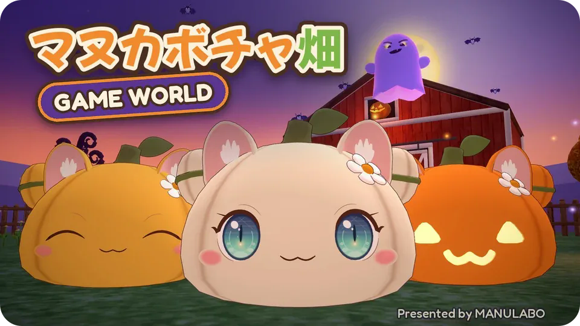</a>

<p align="center"><a href="https://vrchat.com/home/launch?worldId=wrld_83f0434e-b702-4e73-bfd2-913816ef5ed5">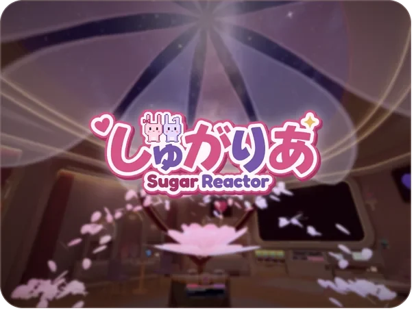</a><a href="https://vrchat.com/home/launch?worldId=wrld_4a41c522-fc84-4cc0-aee4-ab2fddee73f1">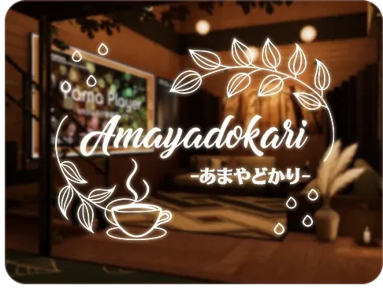</a><a href="https://vrchat.com/home/launch?worldId=wrld_12c89f0b-81c4-4d8f-9184-eb07143e961a">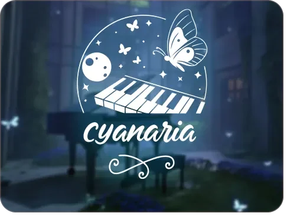</a><a href="https://vrchat.com/home/group/grp_cf22616c-5903-4467-87e9-f1ebd5d592dd">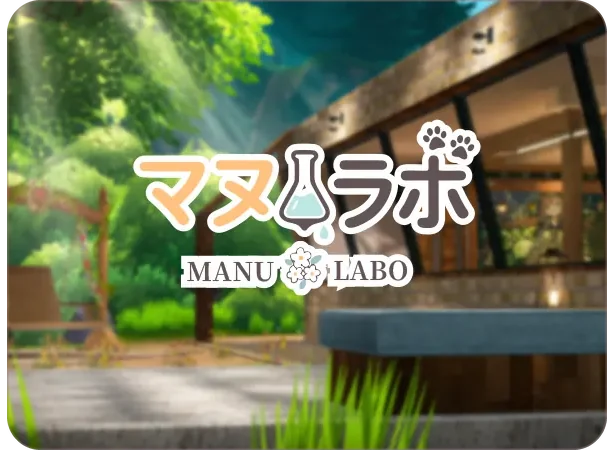</a></p>

- **[マヌカボチャ畑](https://vrchat.com/home/launch?worldId=wrld_5c8bdc4f-4ada-4f66-9289-5497ec01c874)** — 公開 · 2026.10 · 最大4人で遊ぶ協力ミニゲーム。日本語・英語・韓国語・中国語に対応。マヌカ集会イベント #マヌラボ の主催で制作
- **[しゅがりあ -Sugar Reactor-](https://vrchat.com/home/launch?worldId=wrld_83f0434e-b702-4e73-bfd2-913816ef5ed5)** — 公開 · 2026.10 · いちごミルク色のラウンジ。PC / Android / iOS
- **[あまやどかり](https://vrchat.com/home/launch?worldId=wrld_4a41c522-fc84-4cc0-aee4-ab2fddee73f1)** — 公開 · 雨宿りのためのワールド。公開2日で20,000 visits / 3,300 favorites
- **[Cyanaria](https://vrchat.com/home/launch?worldId=wrld_12c89f0b-81c4-4d8f-9184-eb07143e961a)** — 公開 · 青い光と水の気配を楽しむワールド
- **[マヌラボ](https://vrchat.com/home/group/grp_cf22616c-5903-4467-87e9-f1ebd5d592dd)** — イベント用（非公開）· Webから動かせる連動ギミックも担当
- **灯の館** — 過去に担当したワールド。イベント用（非公開）· イベントの雰囲気に合わせて空間を設計しました。現在は担当していません


## NiAkaDo / NiAka堂

ワールド制作で面倒だったところを、小さな道具にして[BOOTH](https://niaka.booth.pm/)で配布しています。無料で使えるものもあります。

<p align="center"><a href="https://niaka.booth.pm/items/8936165">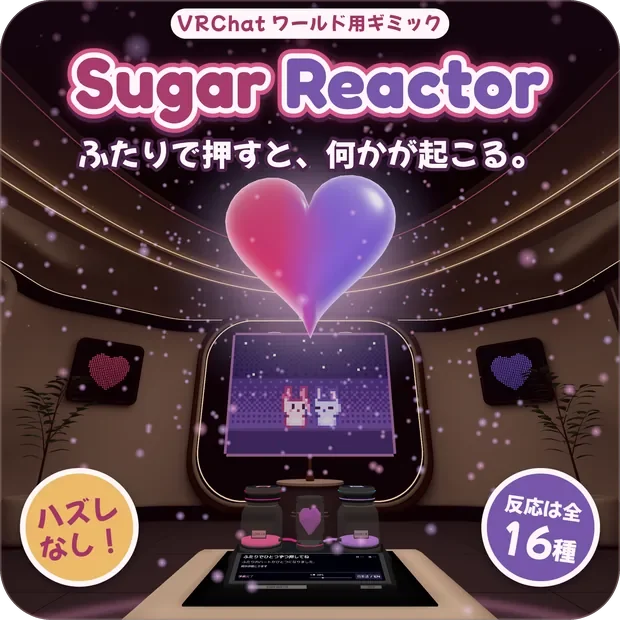</a><a href="https://niaka.booth.pm/items/8752801">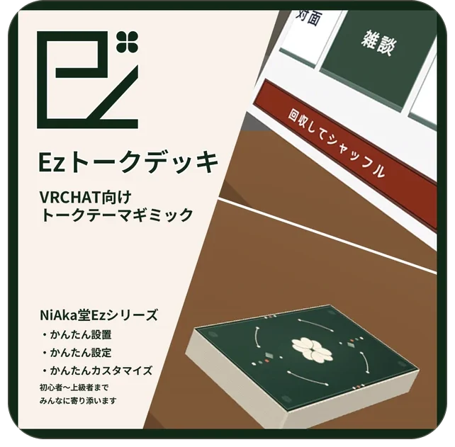</a><a href="https://niaka.booth.pm/items/9123231">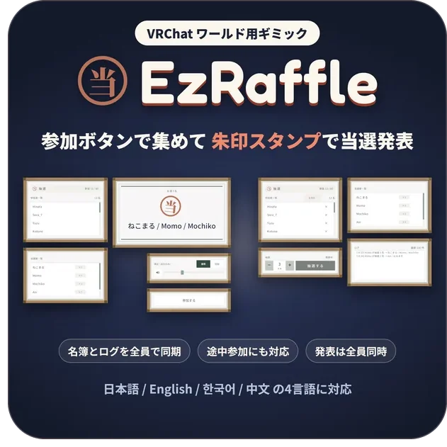</a><a href="https://booth.pm/ja/items/8568688">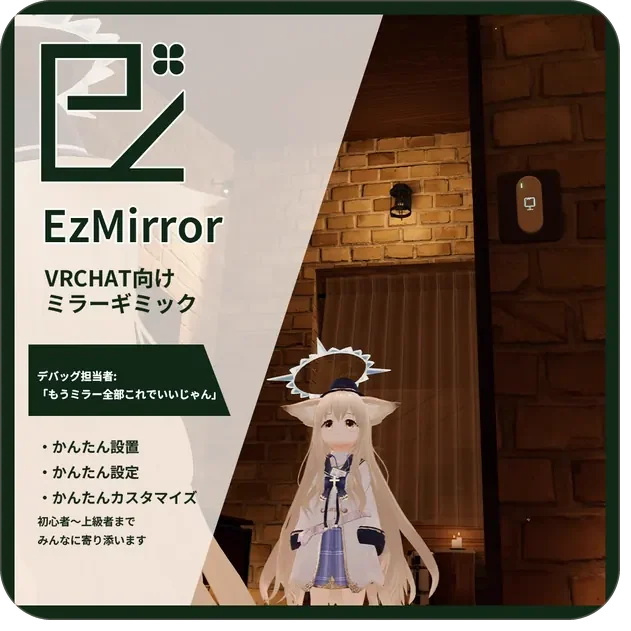</a><a href="https://booth.pm/ja/items/8320267">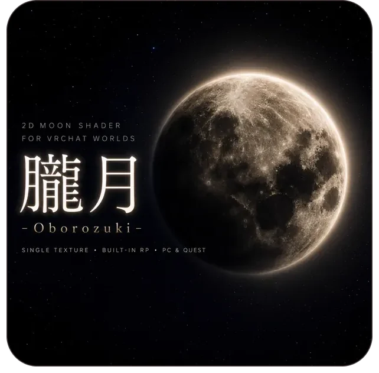</a><a href="https://booth.pm/ja/items/7719130">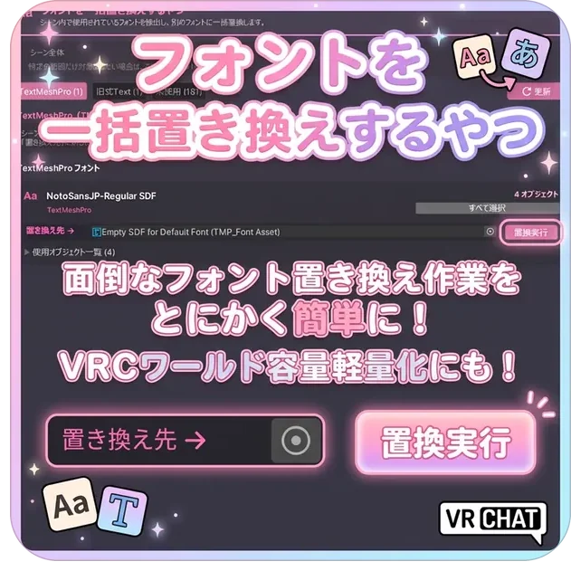</a></p>

<a href="https://vpm.2aka.io/">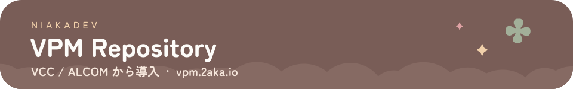</a>

- **[Sugar Reactor](https://niaka.booth.pm/items/8936165)** — Udonギミック · 4言語
- **[Ezトークデッキ](https://niaka.booth.pm/items/8752801)** — 会話カードのUdonギミック · 4言語
- **[EzRaffle](https://niaka.booth.pm/items/9123231)** — 抽選のUdonギミック · 4言語 · 無料
- **[EzMirror](https://booth.pm/ja/items/8568688)** — ワールド用ミラー · 無料
- **[朧月](https://booth.pm/ja/items/8320267)** — 月のシェーダー · 無料
- **[フォントを一括置き換えするやつ](https://booth.pm/ja/items/7719130)** — Unityエディタ拡張
- **[NiAkaDev VPM Repository](https://vpm.2aka.io/)** — VCC / ALCOMから導入 · [`index.json`](https://vpm.2aka.io/index.json)

*Small tools made while building VRChat worlds.*


## Web Development

フロントからAPI、データベース、インフラまで担当します。一番得意な言語はTypeScriptです。要件の整理から実装、公開後の運用まで手がけていて、作って終わりではなく、公開してから直していく仕事が好きです。CTOや開発リードとして、技術選定、設計、レビューも見てきました。

<p align="center"><a href="https://site.shijukairadio.com/">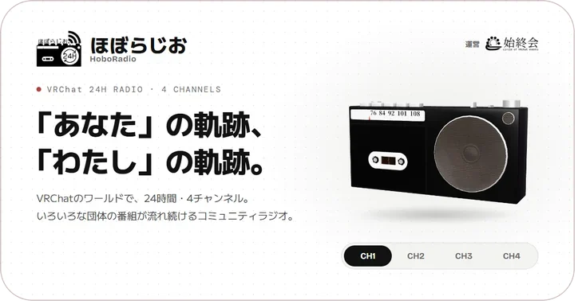</a><a href="https://vrc-aquelia.com/">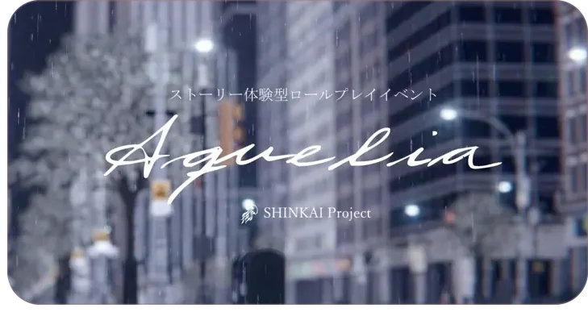</a>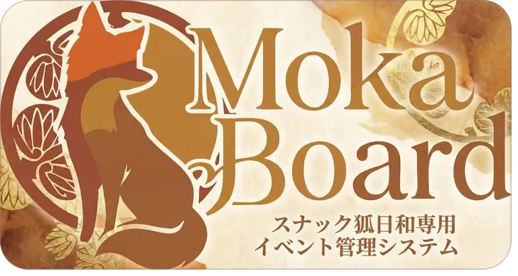<a href="https://metacopi.2aka.io/">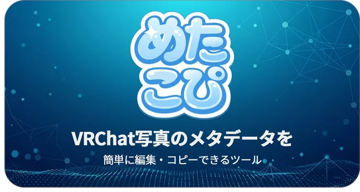</a></p>

- **[ほぼらじお 公式サイト](https://site.shijukairadio.com/)**（2026.11）— 始終会が運営する、VRChatの24時間コミュニティラジオ「ほぼらじお」の公式サイトです。デザインと開発を担当しました。`Astro` `React` `Cloudflare Workers`
- **[深海プロジェクト Aquelia](https://vrc-aquelia.com/)** — 公式サイトと登場人物管理システム「観測室」に加え、ワールド内のUdonギミック一式の開発と継続保守を担当しています。`Next.js` `React` `Cloudflare D1・R2` `UdonSharp`
- **MokaBoard** — 「スナック狐日和」専用のギミックです。Webシステムとワールド内の表示をつないでいます。
- **[めたこぴ for VRC](https://metacopi.2aka.io/)** — VRChat写真のXMPメタデータを、ブラウザだけで閲覧・編集・コピーするツールです。画像はサーバーへ送りません。`Astro` `React` `TypeScript`
- **Brown Wave** — 過去の個人開発。サウンドミキサー · 公開終了

めたこぴ for VRCとBrown Waveは、仕事とは別に、趣味で作ったWebアプリです。勤務先や受託案件の制作物ではありません。

<details>
<summary><strong>よく使う技術 / Stack</strong></summary>

| | よく使うもの |
| --- | --- |
| Primary | `TypeScript` |
| Frontend | `React` `Next.js` `Astro` |
| Backend | `Node.js` `Hono` `Deno` `Laravel` `Python` `REST API` |
| Platform | `Cloudflare` `AWS` `Docker` |
| Quality | `CI/CD` `E2E` `Visual Regression Testing` |

</details>

*I work across the stack, from product requirements and UI to APIs, infrastructure, and operations. The two personal web apps above are independent hobby projects.*


## Collaborations / 制作協力・技術協力

ほかの人の作品に、動画やコードで関わった仕事です。作品の作者は、それぞれの制作者やチームです。

- **[こもれび With Rinasciita プロモーション動画](https://x.com/Riisya_Sweets/status/2116795253256757515)**（2026.11）— リーシャさんのワールド「初心者案内ワールド こもれび With Rinasciita」の宣伝動画です。構成・撮影・編集を担当し、リーシャさんのXで公開されました。
- **[HoboRadio / ほぼらじお（ラジオギミック）](https://booth.pm/ja/items/8041466)** — 始終会が開発・運営するVRChat向けラジオギミックです。こちらは開発アドバイザーとして、コードレビューと設計・実装の助言を担当しています。公式頒布ページでは「外部協力・技術サポート」としてクレジットされています。[GitHub](https://github.com/Shijukai/HoboRadio)

*Promotion video production and technical advisory work for other creators' projects.*

## About

仕事ではフルスタックのWeb開発、個人ではVRChatのワールドやUnity向けツールを作っています。コードを書くこと自体より、実際に使えるところまで持っていくほうが好きです。最近はAIエージェントを使った開発のやり方を試しつつ、良かったものをOSSに戻しています。

*I like shipping things, watching how people use them, and improving them after release.*

<p align="center">
  <a href="https://github.com/niaka3dayo">GitHub</a> ·
  <a href="https://zenn.dev/nayushi">Zenn</a> ·
  <a href="https://note.com/2aka">note</a> ·
  <a href="https://x.com/niaka3vrc">X</a> ·
  <a href="https://niaka.booth.pm/">BOOTH</a> ·
  <a href="https://vpm.2aka.io/">VPM</a>
</p>

<a href="https://niaka.booth.pm/">
  <picture>
    <source media="(prefers-color-scheme: dark)" srcset="./assets/footer-dark.svg">
    <source media="(prefers-color-scheme: light)" srcset="./assets/footer-light.svg">
    
  </picture>
</a>

<sub>
このREADMEでは、個人名義で公開できる活動と成果物の一部だけを紹介しています。勤務先で担当した案件、受託で開発したアプリケーション・Webサイト、詳細な職務経歴は、守秘義務や契約、関係者のプライバシーを尊重するため掲載していません。公開できる範囲の経験については、必要に応じて個別に説明します。<br>
<i>This profile intentionally focuses on work that can be shared publicly. Professional and client projects are omitted where confidentiality, contractual obligations, or privacy apply.</i>
</sub>
