<picture>
  <source media="(prefers-color-scheme: dark)" srcset="./assets/hero-dark.svg">
  <source media="(prefers-color-scheme: light)" srcset="./assets/hero-light.svg">
  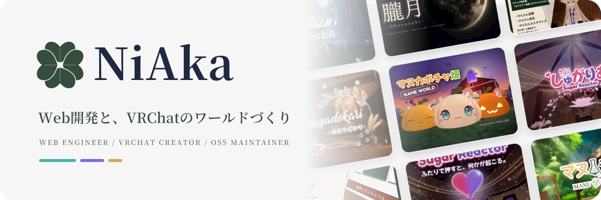
</picture>

## はじめまして、NiAkaです。

TypeScriptを中心に、Webアプリケーションの設計・開発・運用をしています。個人では、VRChatのワールドやギミック、Unity向けのツールを作っています。AIエージェントにUdonSharpをちゃんと書かせるためのOSSも育てています。

*Full-stack web engineer. I also build VRChat worlds and tools, and maintain open-source skills that help coding agents write better UdonSharp.*

<table>
  <tr>
    <td align="center" width="33%"><strong>300+</strong><br><sub>OSS GitHub Stars</sub></td>
    <td align="center" width="33%"><strong>6+ years</strong><br><sub>Web Development</sub></td>
    <td align="center" width="33%"><strong>20K visits</strong><br><sub>in 2 days — あまやどかり</sub></td>
  </tr>
</table>

[最近の仕事](#latest--最近の仕事) · [Open Source](#open-source) · [VRChat Worlds](#vrchat-worlds) · [NiAka堂](#niakado--niaka堂) · [Web Development](#web-development) · [制作協力・技術協力](#collaborations--制作協力技術協力)

## Latest / 最近の仕事

<table>
  <tr>
    <td width="33%" valign="top">
      <a href="https://x.com/Riisya_Sweets/status/2116795253256757515">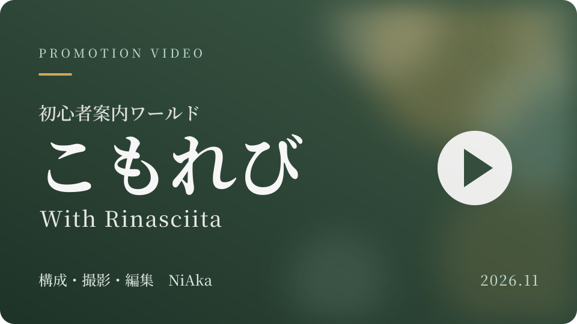</a><br>
      <sub>2026.11 · 制作協力</sub><br>
      <strong><a href="https://x.com/Riisya_Sweets/status/2116795253256757515">こもれび プロモーション動画</a></strong><br>
      <sub>リーシャさんのワールドの宣伝動画。構成・撮影・編集を担当しました。</sub>
    </td>
    <td width="33%" valign="top">
      <a href="https://vrchat.com/home/launch?worldId=wrld_5c8bdc4f-4ada-4f66-9289-5497ec01c874">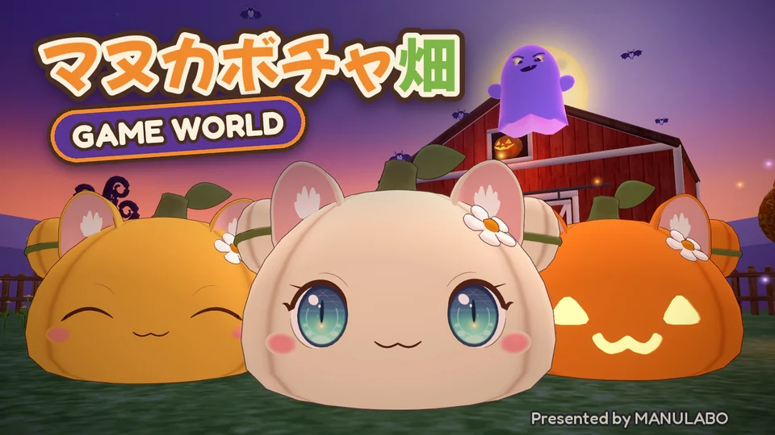</a><br>
      <sub>2026.10 · 公開ワールド</sub><br>
      <strong><a href="https://vrchat.com/home/launch?worldId=wrld_5c8bdc4f-4ada-4f66-9289-5497ec01c874">マヌカボチャ畑</a></strong><br>
      <sub>最大4人で遊ぶ協力ミニゲーム。日本語・英語・韓国語・中国語に対応。</sub>
    </td>
    <td width="33%" valign="top">
      <a href="https://niaka.booth.pm/items/8936165">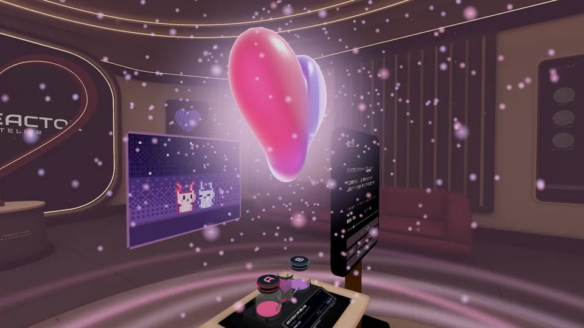</a><br>
      <sub>2026.10 · BOOTH</sub><br>
      <strong><a href="https://niaka.booth.pm/items/8936165">Sugar Reactor</a></strong><br>
      <sub>ふたりでキャップを押すと、16種類の反応のうち1つが起こるワールド用ギミック。</sub>
    </td>
  </tr>
</table>

## Open Source

### [agent-skills-vrc-udon](https://github.com/niaka3dayo/agent-skills-vrc-udon)

> **AIが書くUdonSharpを、もう少しまともにする。**

普通のC#では通るのに、UdonSharpでは使えない書き方が結構あります。このリポジトリには、その違いをAIエージェントへ教えるルール、実装例、チェック用のフックをまとめています。Claude Code、Codex、Cursorなどで使えるAgent Skillsで、日本語を含む5言語に対応しています。

```sh
npx skills add niaka3dayo/agent-skills-vrc-udon
```

*Rules, examples, and validation hooks for agents that write UdonSharp. I make agents dance.*

## VRChat Worlds

自分で作ったワールドです。公開ワールドはワールドのページへ、イベント用の非公開ワールドは、そのイベントのVRChatグループへつながります。

<table>
  <tr>
    <td width="33%" valign="top">
      <a href="https://vrchat.com/home/launch?worldId=wrld_5c8bdc4f-4ada-4f66-9289-5497ec01c874">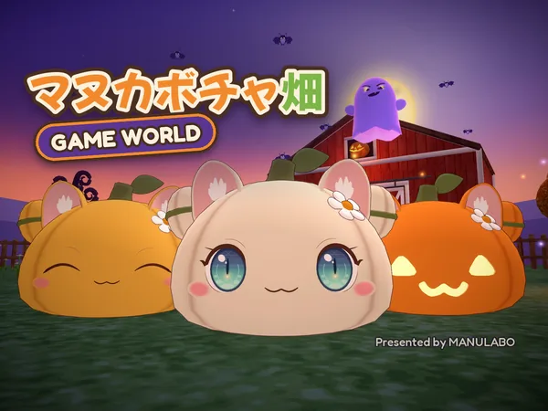</a><br>
      <strong><a href="https://vrchat.com/home/launch?worldId=wrld_5c8bdc4f-4ada-4f66-9289-5497ec01c874">マヌカボチャ畑</a></strong><br>
      <sub>公開 · 2026.10 · 協力ミニゲーム。マヌカ集会イベント #マヌラボ の主催で制作</sub>
    </td>
    <td width="33%" valign="top">
      <a href="https://vrchat.com/home/launch?worldId=wrld_83f0434e-b702-4e73-bfd2-913816ef5ed5">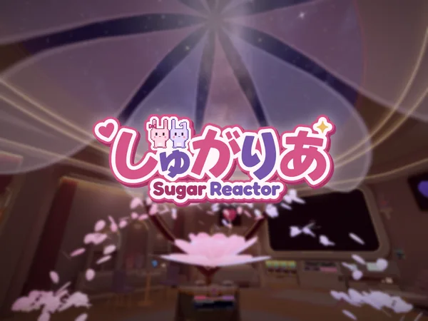</a><br>
      <strong><a href="https://vrchat.com/home/launch?worldId=wrld_83f0434e-b702-4e73-bfd2-913816ef5ed5">しゅがりあ -Sugar Reactor-</a></strong><br>
      <sub>公開 · 2026.10 · いちごミルク色のラウンジ。PC / Android / iOS</sub>
    </td>
    <td width="33%" valign="top">
      <a href="https://vrchat.com/home/launch?worldId=wrld_4a41c522-fc84-4cc0-aee4-ab2fddee73f1">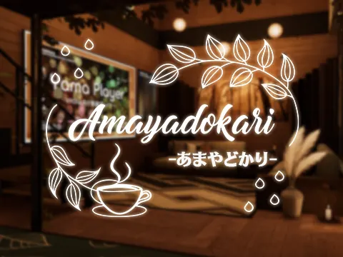</a><br>
      <strong><a href="https://vrchat.com/home/launch?worldId=wrld_4a41c522-fc84-4cc0-aee4-ab2fddee73f1">あまやどかり</a></strong><br>
      <sub>公開 · 雨宿りのためのワールド。公開2日で20,000 visits / 3,300 favorites</sub>
    </td>
  </tr>
  <tr>
    <td width="33%" valign="top">
      <a href="https://vrchat.com/home/launch?worldId=wrld_12c89f0b-81c4-4d8f-9184-eb07143e961a">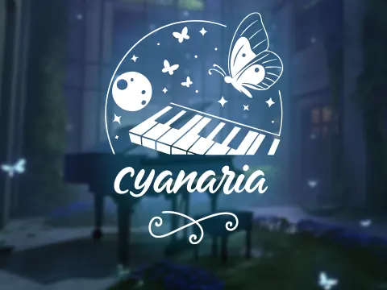</a><br>
      <strong><a href="https://vrchat.com/home/launch?worldId=wrld_12c89f0b-81c4-4d8f-9184-eb07143e961a">Cyanaria</a></strong><br>
      <sub>公開 · 青い光と水の気配を楽しむワールド</sub>
    </td>
    <td width="33%" valign="top">
      <a href="https://vrchat.com/home/group/grp_cf22616c-5903-4467-87e9-f1ebd5d592dd">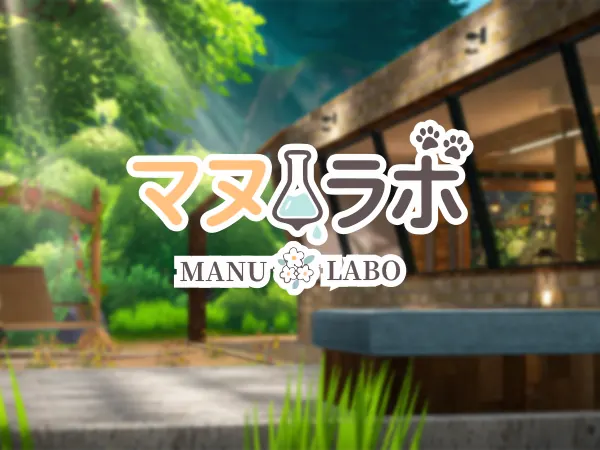</a><br>
      <strong><a href="https://vrchat.com/home/group/grp_cf22616c-5903-4467-87e9-f1ebd5d592dd">マヌラボ</a></strong><br>
      <sub>イベント用（非公開）· Webから動かせる連動ギミックも担当</sub>
    </td>
    <td width="33%" valign="top">
      <sub>過去に担当したワールド</sub><br>
      <strong>灯の館</strong><br>
      <sub>イベント用（非公開）· イベントの雰囲気に合わせて空間を設計しました。現在は担当していません</sub>
    </td>
  </tr>
</table>

## NiAkaDo / NiAka堂

ワールド制作で面倒だったところを、小さな道具にして[BOOTH](https://niaka.booth.pm/)で配布しています。無料で使えるものもあります。

<table>
  <tr>
    <td width="33%" valign="top">
      <a href="https://niaka.booth.pm/items/8936165">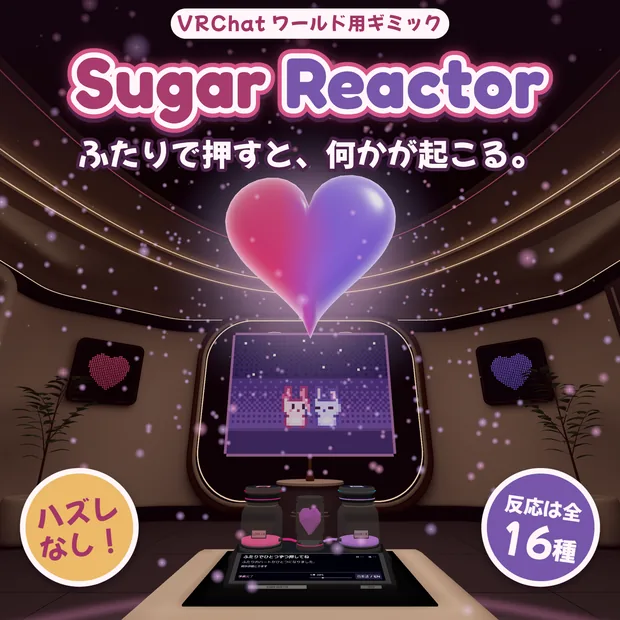</a><br>
      <strong><a href="https://niaka.booth.pm/items/8936165">Sugar Reactor</a></strong><br>
      <sub>Udonギミック · 4言語</sub>
    </td>
    <td width="33%" valign="top">
      <a href="https://niaka.booth.pm/items/8752801">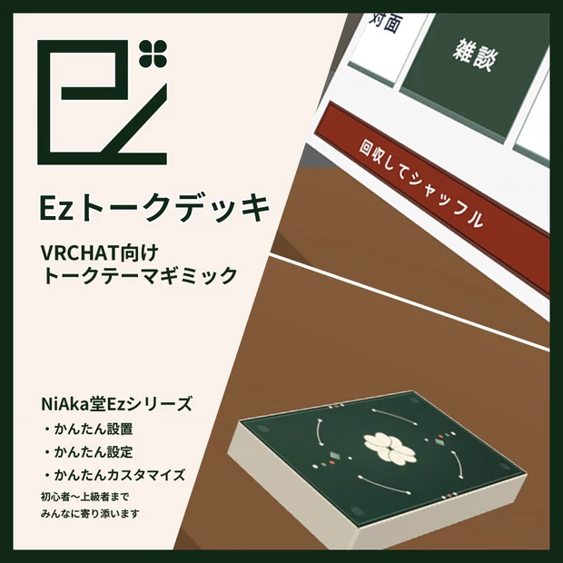</a><br>
      <strong><a href="https://niaka.booth.pm/items/8752801">Ezトークデッキ</a></strong><br>
      <sub>会話カードのUdonギミック · 4言語</sub>
    </td>
    <td width="33%" valign="top">
      <a href="https://booth.pm/ja/items/8568688">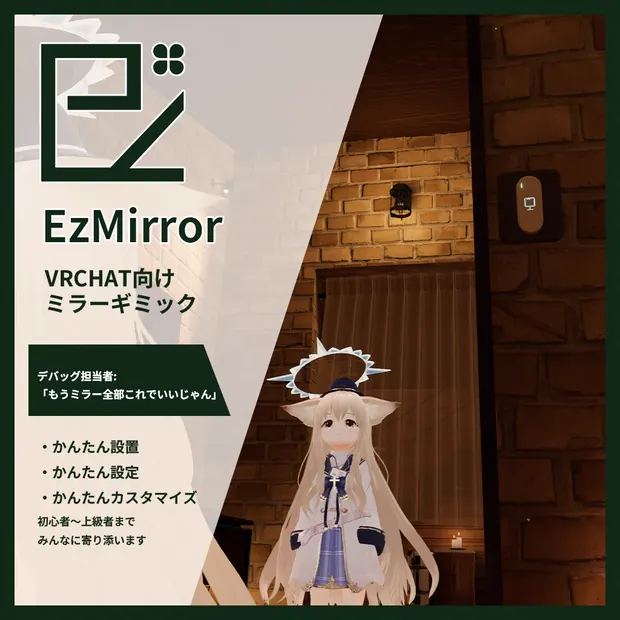</a><br>
      <strong><a href="https://booth.pm/ja/items/8568688">EzMirror</a></strong><br>
      <sub>ワールド用ミラー · 無料</sub>
    </td>
  </tr>
  <tr>
    <td width="33%" valign="top">
      <a href="https://booth.pm/ja/items/8320267">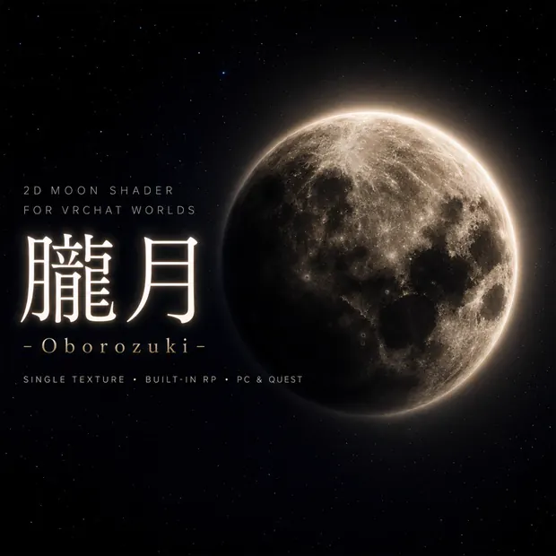</a><br>
      <strong><a href="https://booth.pm/ja/items/8320267">朧月</a></strong><br>
      <sub>月のシェーダー · 無料</sub>
    </td>
    <td width="33%" valign="top">
      <a href="https://booth.pm/ja/items/7719130">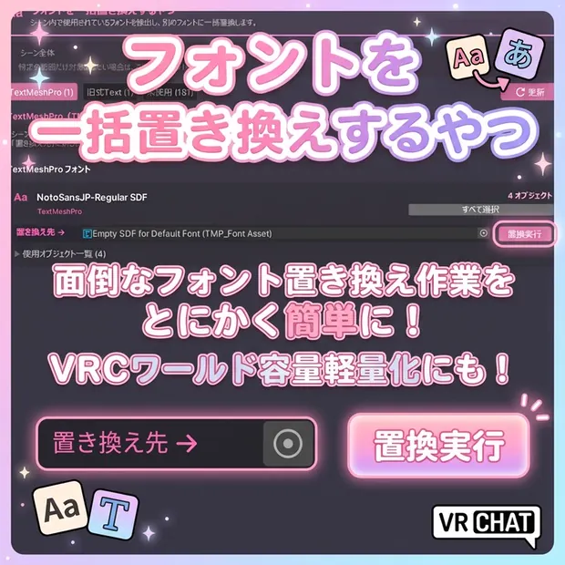</a><br>
      <strong><a href="https://booth.pm/ja/items/7719130">フォントを一括置き換えするやつ</a></strong><br>
      <sub>Unityエディタ拡張</sub>
    </td>
    <td width="33%" valign="top">
      <a href="https://vpm.2aka.io/">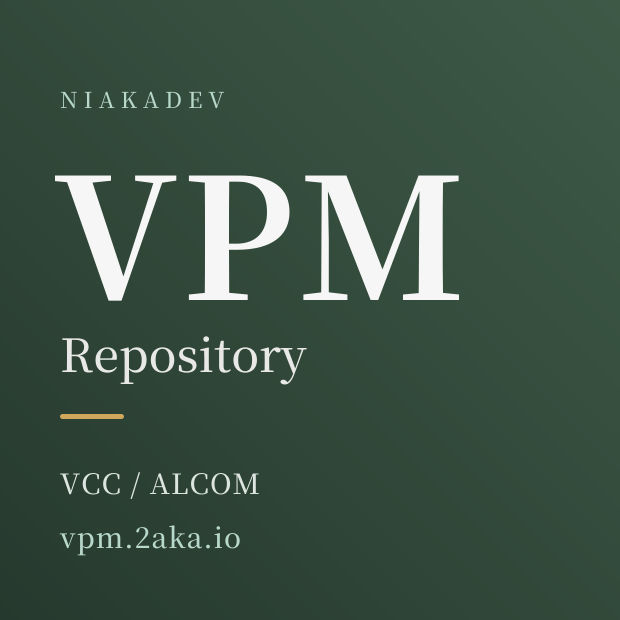</a><br>
      <strong><a href="https://vpm.2aka.io/">NiAkaDev VPM Repository</a></strong><br>
      <sub>VCC / ALCOMから導入 · <a href="https://vpm.2aka.io/index.json"><code>index.json</code></a></sub>
    </td>
  </tr>
</table>

*Small tools made while building VRChat worlds.*

## Web Development

フロントからAPI、データベース、インフラまで担当します。一番得意な言語はTypeScriptです。要件の整理から実装、公開後の運用まで手がけていて、作って終わりではなく、公開してから直していく仕事が好きです。CTOや開発リードとして、技術選定、設計、レビューも見てきました。

<table>
  <tr>
    <td width="25%" valign="top">
      <a href="https://vrc-aquelia.com/">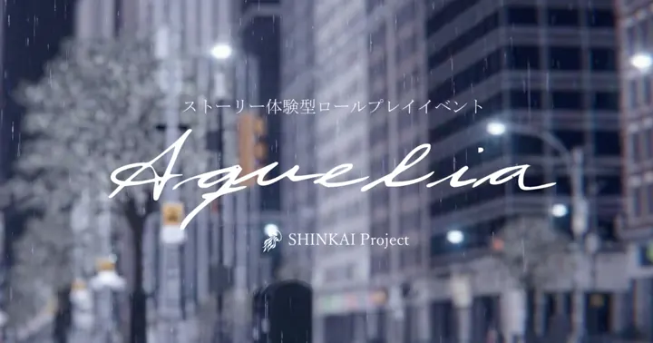</a><br>
      <strong><a href="https://vrc-aquelia.com/">Aquelia</a></strong><br>
      <sub>Web × VRChat</sub>
    </td>
    <td width="25%" valign="top">
      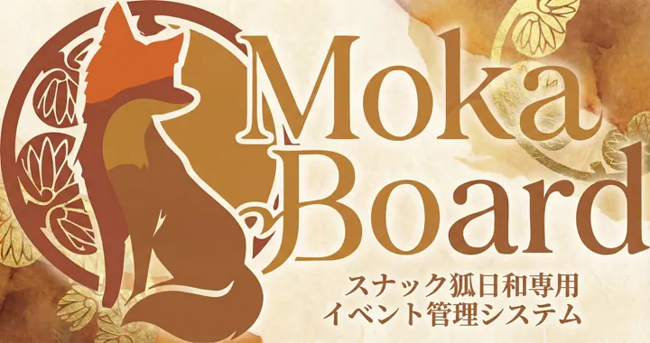<br>
      <strong>MokaBoard</strong><br>
      <sub>Web × VRChat</sub>
    </td>
    <td width="25%" valign="top">
      <a href="https://metacopi.2aka.io/"></a><br>
      <strong><a href="https://metacopi.2aka.io/">めたこぴ</a></strong><br>
      <sub>趣味の個人開発</sub>
    </td>
    <td width="25%" valign="top">
      <a href="https://brown.2aka.io/"></a><br>
      <strong><a href="https://brown.2aka.io/">Brown Wave</a></strong><br>
      <sub>趣味の個人開発</sub>
    </td>
  </tr>
</table>

- **[深海プロジェクト Aquelia](https://vrc-aquelia.com/)** — 公式サイトと登場人物管理システム「観測室」に加え、ワールド内のUdonギミック一式の開発と継続保守を担当しています。`Next.js` `React` `Cloudflare D1・R2` `UdonSharp`
- **MokaBoard** — 「スナック狐日和」専用のギミックです。Webシステムとワールド内の表示をつないでいます。
- **[めたこぴ for VRC](https://metacopi.2aka.io/)** — VRChat写真のXMPメタデータを、ブラウザだけで閲覧・編集・コピーするツールです。画像はサーバーへ送りません。`Astro` `React` `TypeScript`
- **[Brown Wave](https://brown.2aka.io/)** — 集中・休息・入眠向けのアンビエントサウンドミキサーです。`Astro` `React` `Web Audio API`

めたこぴ for VRCとBrown Waveは、仕事とは別に、趣味で企画から運用までしているWebアプリです。勤務先や受託案件の制作物ではありません。

<details>
<summary><strong>よく使う技術 / Stack</strong></summary>

| | よく使うもの |
| --- | --- |
| Primary | `TypeScript` |
| Frontend | `React` `Next.js` `Astro` |
| Backend | `Node.js` `Hono` `Deno` `Laravel` `Python` `REST API` |
| Platform | `Cloudflare` `AWS` `Docker` |
| Quality | `CI/CD` `E2E` `Visual Regression Testing` |

</details>

*I work across the stack, from product requirements and UI to APIs, infrastructure, and operations. The two personal web apps above are independent hobby projects.*

## Collaborations / 制作協力・技術協力

ほかの人の作品に、動画やコードで関わった仕事です。作品の作者は、それぞれの制作者やチームです。

- **[こもれび With Rinasciita プロモーション動画](https://x.com/Riisya_Sweets/status/2116795253256757515)**（2026.11）— リーシャさんのワールド「初心者案内ワールド こもれび With Rinasciita」の宣伝動画です。構成・撮影・編集を担当し、リーシャさんのXで公開されました。
- **[HoboRadio / ほぼらじお](https://booth.pm/ja/items/8041466)** — 始終会が開発・運営するVRChat向けラジオギミックです。開発アドバイザーとして、コードレビューと設計・実装の助言を担当しています。公式頒布ページでは「外部協力・技術サポート」としてクレジットされています。[GitHub](https://github.com/Shijukai/HoboRadio)

*Promotion video production and technical advisory work for other creators' projects.*

## About

仕事ではフルスタックのWeb開発、個人ではVRChatのワールドやUnity向けツールを作っています。コードを書くこと自体より、実際に使えるところまで持っていくほうが好きです。最近はAIエージェントを使った開発のやり方を試しつつ、良かったものをOSSに戻しています。

*I like shipping things, watching how people use them, and improving them after release.*

[GitHub](https://github.com/niaka3dayo) · [Zenn](https://zenn.dev/nayushi) · [note](https://note.com/2aka) · [X](https://x.com/niaka3vrc) · [BOOTH](https://niaka.booth.pm/) · [VPM](https://vpm.2aka.io/)

---

<sub>
このREADMEでは、個人名義で公開できる活動と成果物の一部だけを紹介しています。勤務先で担当した案件、受託で開発したアプリケーション・Webサイト、詳細な職務経歴は、守秘義務や契約、関係者のプライバシーを尊重するため掲載していません。公開できる範囲の経験については、必要に応じて個別に説明します。<br>
<i>This profile intentionally focuses on work that can be shared publicly. Professional and client projects are omitted where confidentiality, contractual obligations, or privacy apply.</i>
</sub>
